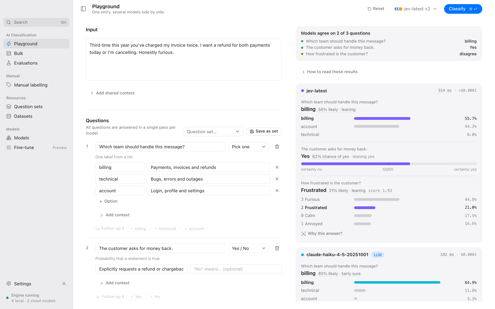
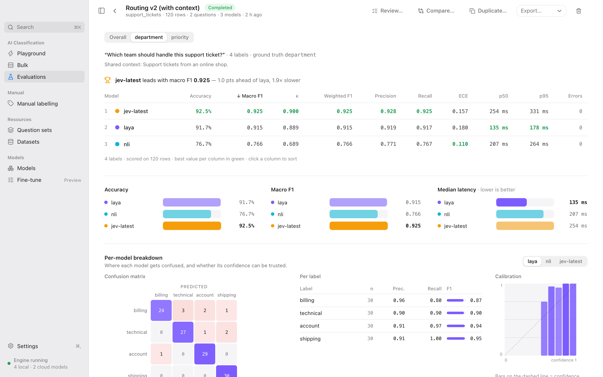
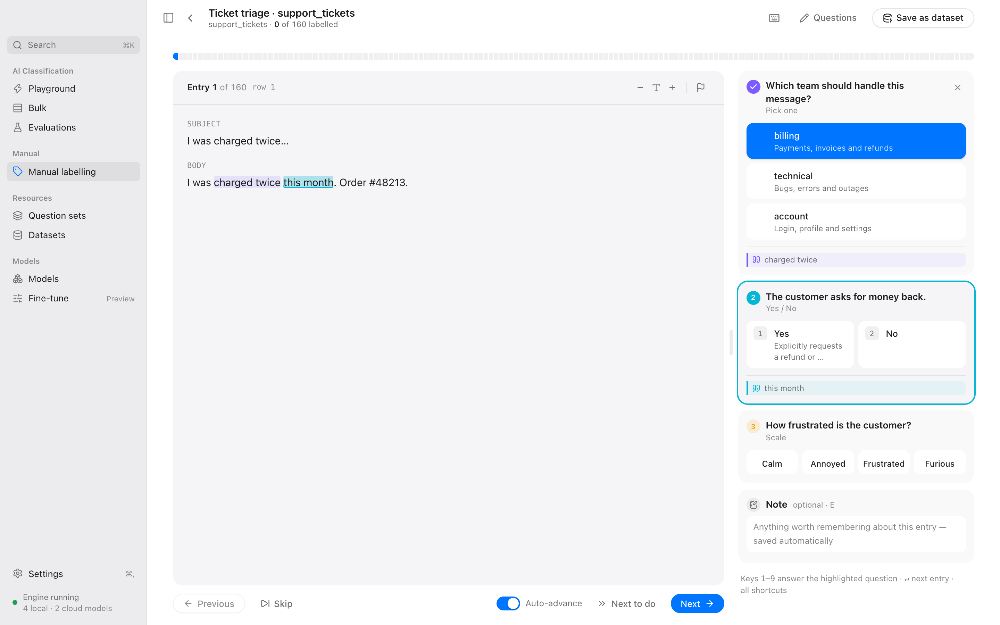
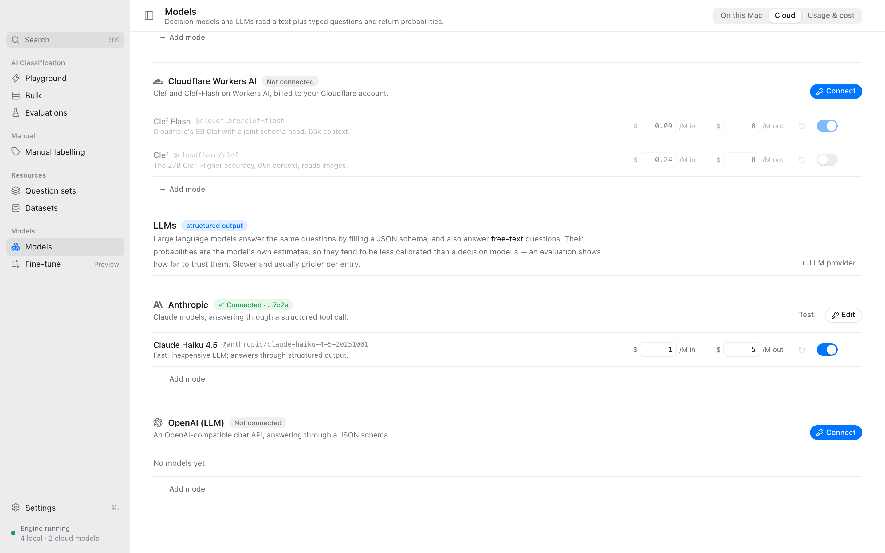

<p align="center">
  
</p>

<h1 align="center">ClassifAI Studio</h1>

<p align="center">
  A desktop app for classifying and labelling text with decision models and LLMs,<br>
  and for checking how well they do on your own data.
</p>

<p align="center">
  <a href="https://jonasweinert.github.io/classifai-studio/">Website</a> ·
  <a href="https://github.com/jonasweinert/classifai-studio/releases/latest">Download</a> ·
  <a href="#build-from-source">Build from source</a> ·
  <a href="#development">Development</a>
</p>



You write questions about your text, such as "Which team should handle this message?" or "The customer asks for money back". Models answer them for every entry, with a probability for each answer. You can run several models on the same questions, compare them against labels you trust, and label entries yourself where you have no labels yet.

ClassifAI Studio works with two kinds of models and treats them the same way:

**Decision models** are made for classification. They take the input and the questions and return a probability for each option, read from the model itself. They are fast, cheap and usually well calibrated. They run on your Mac through [Ollaya](https://github.com/ollaya-dev/ollaya), or through a hosted API (TypeSafe, OpenAI Decisions, Cloudflare Workers AI, or any TypeSafe-compatible endpoint).

**LLMs** such as Claude, GPT, Gemini or Llama answer the same questions through structured output. ClassifAI Studio turns your questions into a JSON schema, so an LLM's answers come back in the same shape as a decision model's. LLMs also quote the part of the input they relied on, and they can answer free-text questions. Their probabilities are their own estimates, so an evaluation is the way to find out how far to trust them. Anthropic, OpenAI, OpenRouter, Groq, Ollama, LM Studio and any other OpenAI-compatible server work.

## What it does

**Playground.** Paste one entry, or open a row of a dataset, and ask the same questions of several models at once. Answers show the full distribution, how sure the model is, and whether the models agree. "Why this answer?" removes parts of the input one at a time to see what a decision model relied on, and shows the quoted passage for an LLM.

**Questions.** Pick one, pick any, yes/no, scale, rank, number and free text. Each question can have its own context and option descriptions. A question can have follow-ups that are only asked for certain answers ("if No, ask why"); models answer them in a second pass with the earlier answers added to the input. Question sets are versioned and can be imported from JSON, CSV or JSON Schema.

**Evaluations.** Run a dataset through several models and score every question against its ground-truth column: accuracy, macro and weighted F1, Cohen's κ, precision, recall, calibration error (ECE) and latency. Confusion matrices, calibration charts and per-label results show where a model goes wrong. A review queue lists the least confident and wrong answers, and corrections you make there update the scores. Reports export to Markdown or HTML.



**Manual labelling.** Label a dataset entry by entry with keyboard shortcuts. Select a passage (or hold ⌥ and move by sentence) and press ↵ to save it as the evidence for an answer. Follow-up questions appear when they apply. The result is saved as a dataset you can evaluate models against.



**Bulk.** Answer the same questions for many entries with one model and save the answers as a dataset or CSV.

**Data.** Import CSV, TSV, JSON and JSONL, Excel and OpenDocument workbooks, datasets from the Hugging Face Hub (with sampling and filters), and folders of Word documents, PDFs, text files and images.

**Costs and privacy.** Local models are free and nothing leaves your Mac. For cloud models you set the price per token, see the spend per model, and can set a monthly budget. API keys are kept in the macOS Keychain.



## Download

Builds for Apple Silicon Macs are on the [releases page](https://github.com/jonasweinert/classifai-studio/releases). Open the `.dmg` and drag ClassifAI Studio into Applications.

> [!WARNING]
> The app is not signed with an Apple Developer ID or notarised by Apple yet. macOS will say it "cannot be opened" or "is damaged" the first time. To open it anyway, either
> - right-click the app in Applications, choose **Open**, then **Open** again (on macOS 15 and later: try to open it once, then go to **System Settings → Privacy & Security** and click **Open Anyway**), or
> - remove the download quarantine in Terminal: `xattr -dr com.apple.quarantine "/Applications/ClassifAI Studio.app"`
>
> Only do this for builds you downloaded from this repository. Signed and notarised builds are planned.

## Build from source

You need macOS, Rust (stable), Node 20 or later and pnpm.

```bash
git clone https://github.com/jonasweinert/classifai-studio.git
cd classifai-studio
pnpm install
pnpm tauri build
```

The app is written to `target/release/bundle/macos/ClassifAI Studio.app`.

On first launch it offers to install Ollaya into its own folder (`~/Library/Application Support/dev.classifai.app/engine`, no admin rights) and to download the `laya` model. An `ollaya` already on your `PATH`, or a daemon running on `127.0.0.1:11435`, is used instead. You can skip this and use only cloud models or LLMs.

## Development

```bash
pnpm tauri dev
```

To work on the interface without Rust, run `pnpm dev` and open http://localhost:1420. The browser build uses an in-memory demo backend (`src/lib/mock.ts`) with sample datasets, models and results.

### Layout

```
crates/classifai-core   Rust core: Ollaya and cloud clients, LLM structured output, question routing,
                        dataset import, SQLite store, evaluation runner, metrics, reports
crates/classifai-cli    the `classifai` command line
src-tauri               Tauri shell: commands and events over classifai-core
src                     React interface (Tailwind v4)
scripts                 fake Ollaya/cloud server for tests, license and screenshot generators
docs                    product notes, screenshots and the website
```

### Tests

```bash
cargo test --workspace
pnpm test
```

The end-to-end tests run against a fake server that speaks the Ollaya, TypeSafe, OpenAI, Cloudflare, Chat Completions and Anthropic APIs:

```bash
python3 scripts/fake_ollaya.py 11999 &
CLASSIFAI_TEST_OLLAYA=http://127.0.0.1:11999 cargo test -p classifai-core -- --include-ignored
```

### Command line

The app ships the `classifai` command line tool. Install it from the welcome screen or from Settings → General; it is linked into `/usr/local/bin`, so it works in any terminal (macOS asks for your password once). It uses the same database as the app, so it sees the datasets and evaluations you made there. From a checkout you can also run it with `cargo run -p classifai-cli --`.

```bash
classifai check "Refund my double charge" -m laya -m @typesafe/jev-latest -l billing,technical,account
classifai experiments
classifai export <experiment-id> report.html
```

### Housekeeping

`python3 scripts/licenses.py` regenerates the open source license list shown in the app after dependency changes. `node --experimental-websocket scripts/screenshots.mjs` retakes the screenshots in `docs/screenshots` from the browser build (with `pnpm dev` running and Google Chrome installed).

## License

Copyright © 2026 Jonas Weinert. No license has been chosen yet, so all rights are reserved for now. The open source packages ClassifAI Studio uses are listed, with their licenses, under About → Open source licenses in the app.
